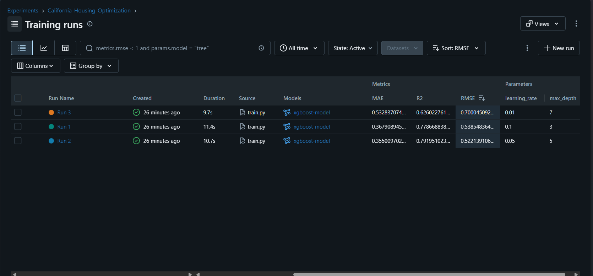

# ML Experiment Tracking with MLflow

## Description
This project predicts California house prices with an XGBoost regressor and uses MLflow
to track three experiments with different hyperparameters. For each run, MLflow records
the parameters (`max_depth`, `learning_rate`), the validation metrics (RMSE, MAE, R²),
and the trained model as an artifact. The best model is selected by lowest RMSE.

- Dataset: California Housing (scikit-learn)
- Split: 80% training / 20% validation, `random_state=42`
- Model: XGBoost, 100 boosting rounds

## How to Run

```powershell
python -m venv mlops-env
mlops-env\Scripts\Activate.ps1
pip install -r requirements.txt
```

Terminal 1 (leave running):

```powershell
mlflow server --backend-store-uri sqlite:///mlruns.db --default-artifact-root ./artifacts --host 127.0.0.1 --port 5000
```

Terminal 2 (same folder, venv activated):

```powershell
python train.py
```

Then open http://127.0.0.1:5000 and select the `California_Housing_Optimization` experiment.

## MLflow Experiment Results



## Comparison Table

| Run   | Max Depth | Learning Rate | RMSE | MAE | R² |
|-------|-----------|---------------|------|-----|----|
| Run 1 | 3         | 0.1           | 0.539|0.368|0.779|
| Run 2 | 5         | 0.05          | 0.522|0.355|0.792|
| Run 3 | 7         | 0.01          | 0.700|0.533|0.626|

## Selected Best Model
Run 2

## Why
RMSE is the primary selection metric, and Run 2 has the lowest validation RMSE (0.522),
meaning the smallest typical prediction error. It is also best on MAE (0.355) and R² (0.792),
so the choice does not depend on which metric is used.

Run 1 (depth 3, lr 0.1) is close but slightly worse, probably because its shallower trees
have less capacity to capture the data. Run 3 (depth 7, lr 0.01) is clearly the worst: with
only 100 boosting rounds, a learning rate of 0.01 is too slow for the model to converge,
so it underfits (R² of 0.626). Run 2's mix of moderate depth and moderate learning rate
gave the best balance.


---

# Lab 2: Deploying the Model with FastAPI, Docker and Kubernetes

## Description
The staging model registered in Lab 1 (`California_Housing_Predictor`) is exported from the
MLflow Model Registry, served through a FastAPI app, packaged in a Docker image, and deployed
to a local Kubernetes cluster (Minikube) with 2 replicas behind a LoadBalancer service.

## Project Files

| File | Purpose |
|------|---------|
| `export_model.py` | Downloads the `staging` model from the MLflow registry into `./model` |
| `app.py` | FastAPI app: loads the model at startup, exposes `/health` and `/predict` |
| `requirements.txt` | Pinned dependencies for the container |
| `Dockerfile` | Builds the serving image |
| `.dockerignore` | Keeps the venv and MLflow data out of the build context |
| `k8s-deployment.yaml` | Deployment (2 replicas, readiness probe) and Service |

## How to Run

Prerequisites: Docker Desktop running, Minikube and kubectl installed.

```powershell
# 1. Export the staging model (MLflow server from Lab 1 must be running)
python export_model.py

# 2. Start the cluster and build the image inside Minikube
minikube start --driver=docker
minikube image build -t california-housing-api:v1 .

# 3. Deploy and check the pods (wait for 1/1 READY)
kubectl apply -f k8s-deployment.yaml
kubectl get pods

# 4. Expose the service locally (leave running)
kubectl port-forward svc/housing-api-service 8080:80
```

Then open http://127.0.0.1:8080/docs and call `POST /predict`, or use curl:

```powershell
curl.exe -X POST http://127.0.0.1:8080/predict -H "Content-Type: application/json" -d "{\"MedInc\":8.3252,\"HouseAge\":41.0,\"AveRooms\":6.9841,\"AveBedrms\":1.0238,\"Population\":322.0,\"AveOccup\":2.5556,\"Latitude\":37.88,\"Longitude\":-122.23}"
```

## Result

Response for the sample input:

```json
{"prediction": "$430,082.65"}
```

The model outputs prices in units of $100,000, so the API multiplies the raw prediction by 100,000.

## Notes
- The container uses `mlflow-skinny`, which is enough to load the model, so the image stays small.
- Library versions match the environment the model was trained in.
- The `/health` endpoint is used as the Kubernetes readiness probe.
